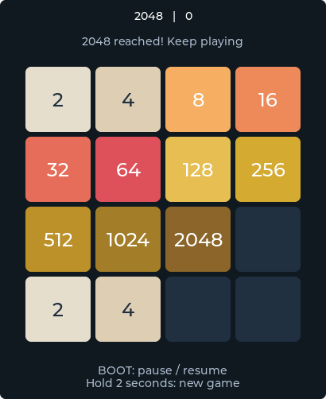

# Digital Projections Watch

An extensible watch system for the ESP32-S3 with a 2.06-inch 410 x 502 AMOLED display.

Version 0.1.3 adds phone-based Wi-Fi setup over Bluetooth Low Energy. Enter the network password on Android instead of the watch keyboard. See [phone setup instructions](docs/phone-wifi-setup.md). Host state and UI tests passed; hardware provisioning verification is in progress.

The installed 0.1.2 swipe-control release passed firmware digest and launch checks. Shared motion calibration, reboot persistence, SD read/write, and physical BOOT controls were verified in 0.1.1. See [0.1.2 validation evidence](docs/watch-validation-0.1.2.json) and [0.1.1 hardware evidence](docs/watch-validation-0.1.1.json).

## Applications

The system includes 2048, GravitySphere, calculator, drawing, gallery, music, recording, video, settings, and AI chat. Factory applications are adapted from the Waveshare 1.75-inch Brookesia source to the 2.06-inch hardware. Original licensing and attribution are retained.

Swipe across the 2048 board to move tiles in that direction. Short taps and ambiguous diagonal swipes are ignored; each contact makes at most one move. BOOT toggles pause and a two-second hold starts a new game. 2048 works independently of motion calibration. In GravitySphere, double-press BOOT to calibrate and hold BOOT to centre the ball.

Calibration is shared across motion apps and saved to NVS. Keep the watch flat and still during calibration. A successful stationary measurement corrects accelerometer and gyroscope bias; it does not perform six-face scale calibration. Calibration reports loading, success, unavailable, or error and has an eight-second deadline.

The image above is a host-rendered UI preview.

## Development

- `python scripts/test_watch.py` runs host tests against the production game and calibration code.
- `scripts\watch_build.cmd build` builds the complete watch system with ESP-IDF 5.5.4. Set `IDF_PATH` if installed elsewhere.
- `python scripts/flash_watch.py --port COM12 --backup PATH` validates a committed build and recovery snapshot; add `--write` to install. Use `--migrate-original-nvs` only for the first migration from the factory image.
- Firmware source: `FirmWare/watch`.
- Upstream examples remain in `examples` as hardware references.

Private full-flash backups stay outside Git. Flashing requires verified backup, passing tests, a successful firmware build, and a committed revision. A successful build alone does not establish that display, touch, motion, audio, or SD work on the device.

## Source provenance

Forked from [Waveshare 2.06](https://github.com/waveshareteam/ESP32-S3-Touch-AMOLED-2.06). Application suite imported from [Waveshare 1.75](https://github.com/waveshareteam/ESP32-S3-Touch-AMOLED-1.75/tree/main/firmware/brookesia). See LICENSE and source headers for upstream terms.
