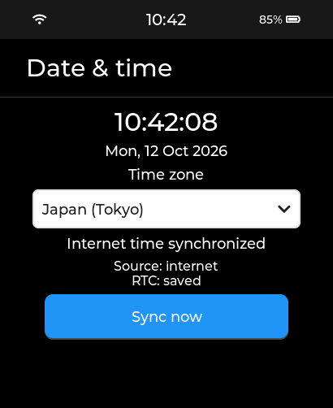

# Internet time and the top status bar

Digital Projections Watch 0.1.9 synchronizes its date and time automatically when Wi-Fi obtains an IP address. Open Settings > Date & time to select a time zone or request Sync now. The selected zone is saved, applies throughout the system and defaults to Japan on an unconfigured watch.

The watch queries pool.ntp.org and retries with Google and Cloudflare time servers if a synchronization attempt times out. The time page distinguishes waiting for Wi-Fi, synchronizing, synchronized, unavailable and error. A failed attempt times out after 30 seconds and retries after 60 seconds; the underlying SNTP client refreshes hourly.

A successful internet update is written to the PCF85063 RTC in UTC, then read back for verification. At boot, a valid saved UTC RTC value initializes the system clock before the next internet sync. The RTC marker prevents treating an older factory-local-time value as UTC. Keeping time across complete power loss depends on the RTC continuing to receive backup power.

The top status bar centers the clock and insets both side areas by 40 pixels. Installed applications reserve the 48-pixel status bar. Before valid time is available, the clock displays --:--. Recorder controls adapt to the reduced app area.

Run `python scripts/test_watch.py` and `python scripts/preview_watch.py` for rules and UI checks. `python scripts/test_clock_usb.py --port COM12` checks real SNTP time, RTC save, timezone changes through the actual UI callbacks, and status widget bounds in Settings, 2048, Recorder and GravitySphere. It restores Japan time after testing.

The implementation uses [ESP-IDF network time guidance](https://docs.espressif.com/projects/esp-idf/en/v5.5.4/esp32s3/api-reference/system/system_time.html).

This preview uses a synthetic date/time and battery percentage; hardware validation is recorded separately.
