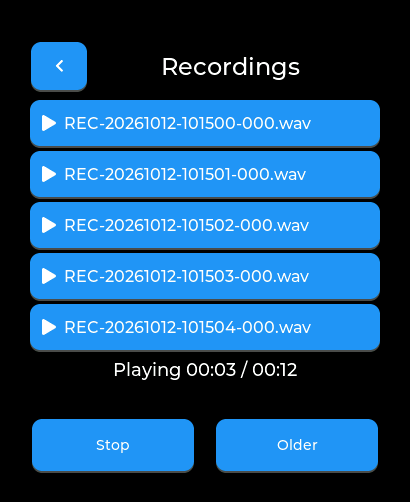

# Recorder playback

Digital Projections Watch 0.1.5 adds playback to the existing SD recorder.

Open Recorder, select Recordings, then tap a saved recording. Stop ends playback. Older shows another five files; return to the recorder and reopen Recordings to start from the latest filenames. The library includes recordings saved in earlier sessions. It never deletes or changes a recording.

The list uses descending filename order, so timestamped recordings appear newest first. Files named before the clock was set use their boot-time names. Incomplete `.partial` recordings are omitted. Playback validates PCM WAV headers and supports 16-bit mono/stereo at 8–48 kHz; the recorder produces 24 kHz stereo. Missing SD, unsupported files and audio ownership failures produce an error instead of pretending playback started.

SD scanning and playback run in a worker. Library memory holds at most six names per page, and playback uses a 1 KiB streaming buffer. Recording and playback share the existing exclusive audio session and SD leases. Closing or pausing the app stops the worker and releases its resources.

Validation: `python scripts/test_watch.py`, `python scripts/preview_watch.py`, and `python scripts/test_recorder_usb.py --port COM12`. The USB test plays existing recordings without modifying them; physical touch and audible quality require a person at the watch. Raw device logs stay in ignored `.local`.

This is a host-rendered preview using synthetic filenames, not a photograph of the watch.
